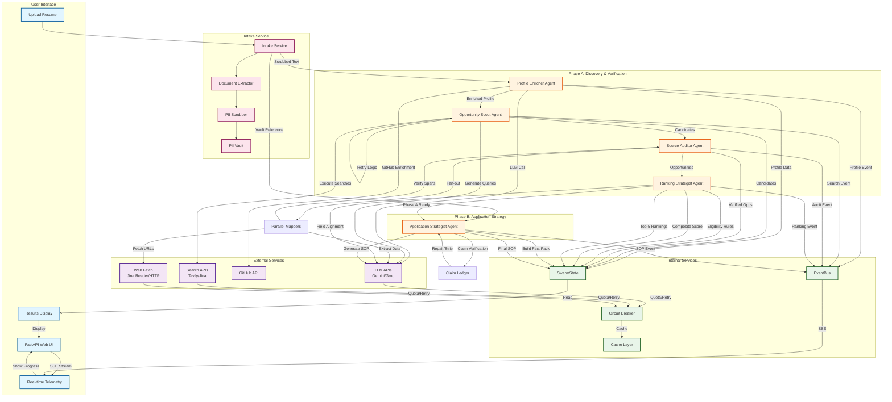

# Agent Workflow Diagram

## System Architecture



## Agent Roles & Responsibilities

### 1. Profile Enricher Agent
**Purpose**: Parse resume and enrich with GitHub profile

**Inputs**:
- Scrubbed resume text (PII removed)
- Optional GitHub username

**Actions**:
- Extract education, skills, projects, language tests
- Normalize GPA to 4.0 scale
- Fetch GitHub signals (projects, languages, activity)
- Compute profile completeness flags

**Outputs**:
- Structured CandidateProfile
- GitHub signals (if available)
- Profile completeness flags

**External APIs**:
- LLM (fast tier) for profile extraction
- GitHub API for profile enrichment

---

### 2. Opportunity Scout Agent
**Purpose**: Discover scholarship and program opportunities

**Inputs**:
- Enriched candidate profile
- Retry count (for second round)

**Actions**:
- Generate 3-5 search queries based on profile
- Execute searches via Tavily API
- Canonicalize URLs and classify trust tiers
- Deduplicate candidates
- Retry with different queries if insufficient results

**Outputs**:
- List of Candidate objects (URLs)
- Search plan with queries used

**External APIs**:
- LLM (fast tier) for query planning
- Tavily API for web search
- Jina/Serper API (secondary fallback)

---

### 3. Source Auditor Agent
**Purpose**: Fetch and verify opportunity details

**Inputs**:
- List of Candidate URLs

**Actions**:
- Fetch official websites (tiered: Jina Reader → HTTP → Browser)
- Extract opportunity details (funding, deadlines, eligibility)
- Verify each extracted attribute against source text (span verification)
- Detect and skip listing/aggregator pages
- Follow links from listing pages to find actual opportunities

**Outputs**:
- Verified Opportunity objects with evidence spans
- Verification results (completeness scores)

**External APIs**:
- LLM (fast tier) for batched extraction
- Jina Reader API for clean markdown
- HTTP clients for direct fetching
- Playwright (optional) for JS-rendered pages

**Special Feature**: Parallel processing via Send API - up to 6 concurrent mappers

---

### 4. Ranking Strategist Agent
**Purpose**: Evaluate eligibility and rank opportunities

**Inputs**:
- Verified opportunities
- Candidate profile

**Actions**:
- Evaluate eligibility using deterministic tri-state rules
- Derive actionable gaps (missing information)
- Score field alignment via LLM (1 reasoning call)
- Compute composite scores (GPA, funding, feasibility, etc.)
- Rank top 5 opportunities

**Outputs**:
- Eligibility assessments with gaps
- Top-5 ranked opportunity IDs
- Rationale for each match

**External APIs**:
- LLM (reasoning tier) for field alignment scoring

---

### 5. Application Strategist Agent
**Purpose**: Generate Statement of Purpose

**Inputs**:
- Top-ranked opportunity
- Candidate profile
- PII Vault (for name rehydration)

**Actions**:
- Build allowed-fact pack from profile + opportunity
- Generate SOP using only allowed facts
- Verify each sentence against fact ledger
- Repair or strip ungrounded sentences
- Rehydrate [CANDIDATE_NAME] placeholder
- Generate execution checklist

**Outputs**:
- Verified SOP with claim ledger
- Execution checklist
- Application package

**External APIs**:
- LLM (fast tier) for SOP generation
- LLM (fast tier) for repair attempts

---

## Data Flow

### SwarmState (Shared Blackboard)
The central state object that all agents read and update:

```python
SwarmState:
  - run_meta: Run metadata (phase, deadlines, budgets)
  - profile: CandidateProfile (set by Agent 1)
  - candidates: List of Candidate URLs (set by Agent 2)
  - opportunities: List of verified Opportunities (set by Agent 3)
  - assessments: Eligibility assessments (set by Agent 4)
  - top_5: Ranked opportunity IDs (set by Agent 4)
  - application_package: SOP and checklist (set by Agent 5)
  - usage_records: API usage telemetry
  - errors: Error list
```

### EventBus (Agent Communication)
Ring-buffer event bus for real-time progress:

```python
Event:
  - run_id: Unique identifier
  - seq: Sequence number
  - timestamp: When event occurred
  - node: Which agent emitted it
  - severity: INFO/WARNING/ERROR
  - kind: NODE_STARTED/PROGRESS/PHASE_A_READY/etc.
  - payload: Additional data
```

---

## Routing Logic

### R1: Enough Candidates?
```python
if candidates >= 8 or retry_count >= max_retries:
    → Source Auditor
else:
    → Retry Scout (generate new queries)
```

### R2: Has Opportunities?
```python
if opportunities >= 1:
    → Ranking Strategist
else:
    → Degraded End (mark as PARTIAL)
```

### R3: SOP Needed?
```python
if top_5 and profile:
    → Application Strategist
else:
    → Complete End
```

---

## Phase Deadlines

### Phase A (Discovery & Verification)
- **Soft Deadline**: 60s - Stop new fetches
- **Hard Deadline**: 75s - Abort Phase A
- **Agents**: Profile Enricher, Opportunity Scout, Source Auditor, Ranking Strategist

### Phase B (Application Strategy)
- **Deadline**: 45s independent
- **Agent**: Application Strategist
- **Trigger**: PHASE_A_READY event

---

## Error Recovery

### Agent-Level Recovery
- **Retry**: Transient errors (network issues) get 2 retries with exponential backoff
- **Failover**: LLM quota errors trigger failover to next model in chain
- **Graceful Degradation**: If insufficient opportunities found, mark as DEGRADED but continue

### System-Level Recovery
- **Circuit Breaker**: Repeated failures on a domain/model open the circuit
- **Quota Governor**: Enforces per-run limits to prevent exhausting monthly quotas
- **Timeout Enforcement**: Every call has a hard timeout; aborts on deadline

---

## Anti-Hallucination Mechanisms

### Stage 1: Span Verification (Source Auditor)
- Every extracted attribute must have a verbatim evidence span
- Verification checks if the value appears in the source text
- Mismatches demote field to UNVERIFIED status

### Stage 2: Claim-Ledger Verification (Application Strategist)
- Allowed-fact pack restricts what LLM can use
- Three deterministic guards per sentence:
  1. Referential integrity (fact IDs must exist)
  2. Numeric token guard (numbers must be in facts)
  3. Proper-noun allow-list (capitalized terms must match)
- Failing sentences get one repair attempt, then are stripped

---

## Privacy Protections

### PII Scrubbing (Intake)
- Names, emails, phone numbers removed before any external call
- Replaced with placeholders like [CANDIDATE_NAME]

### PII Vault
- Sensitive data stored in-memory
- 15-minute auto-purge TTL
- Local rehydration only (never sent to LLM)

### Data Policy
- Uses may_train=False models to prevent training on user data
- No data persistence beyond session
- User can immediately purge all data

---

## Performance Characteristics

### Concurrency
- **Sequential**: Profile enrichment, search planning, ranking, SOP generation
- **Parallel**: Opportunity discovery (up to 6 concurrent searches)
- **Parallel Map-Reduce**: Source auditor (up to 6 concurrent mappers)

### API Usage (Typical Run)
- **LLM Calls**: 15-20 total (≤4 reasoning calls)
- **Search Credits**: 10-15 (Tavily API)
- **Fetch Operations**: 10-20 web pages
- **GitHub API**: 1-2 calls (if username provided)

### Timing
- **Phase A**: 60-75 seconds
- **Phase B**: 30-45 seconds
- **Total**: 90-120 seconds
