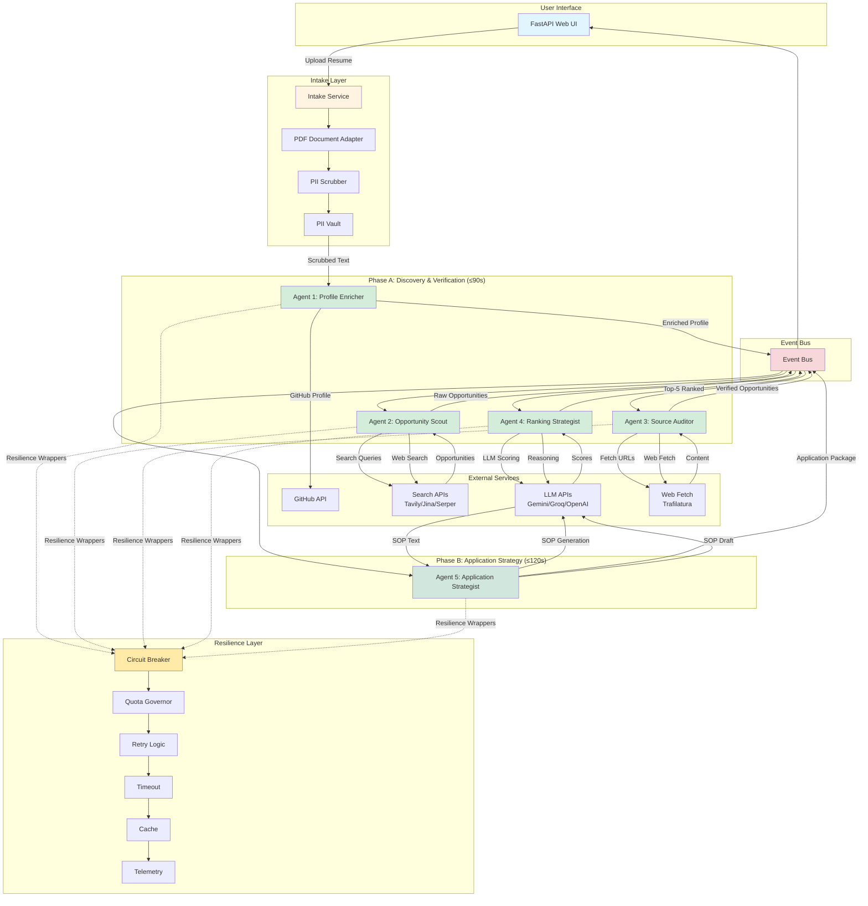
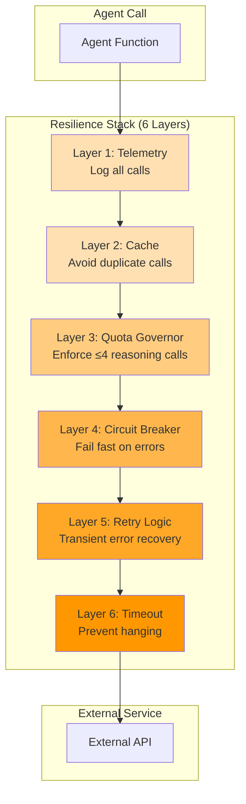
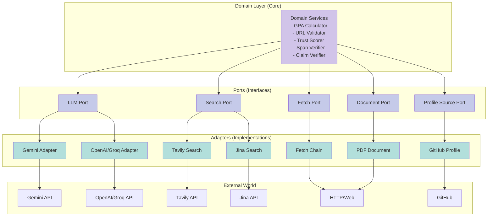
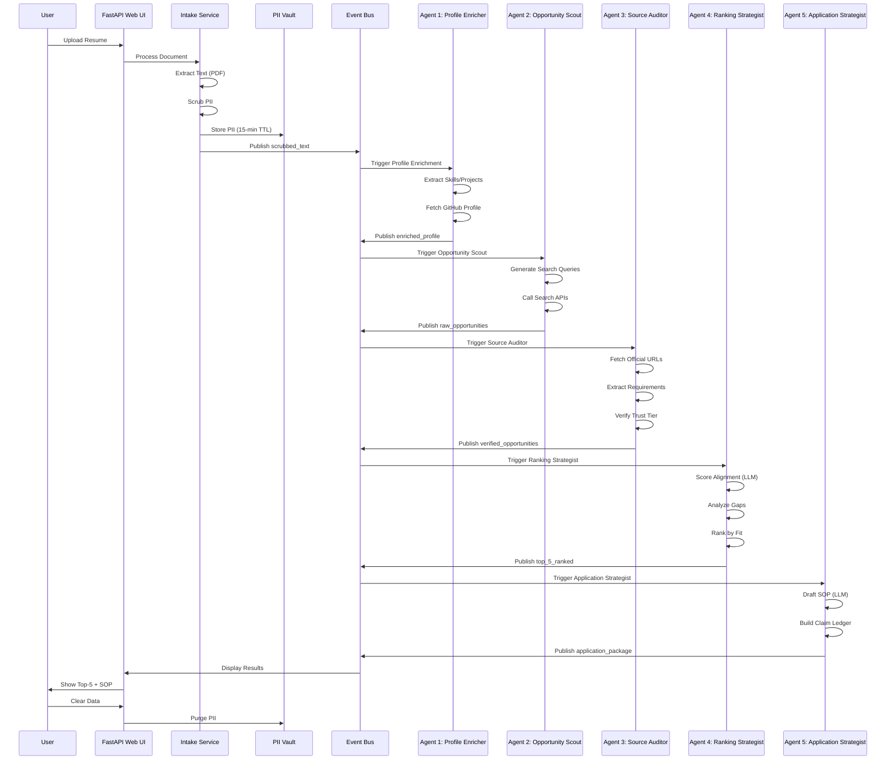
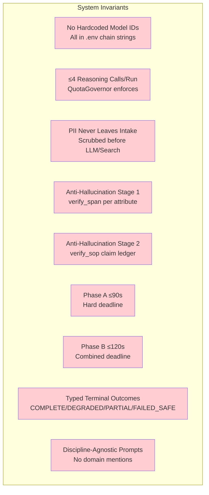
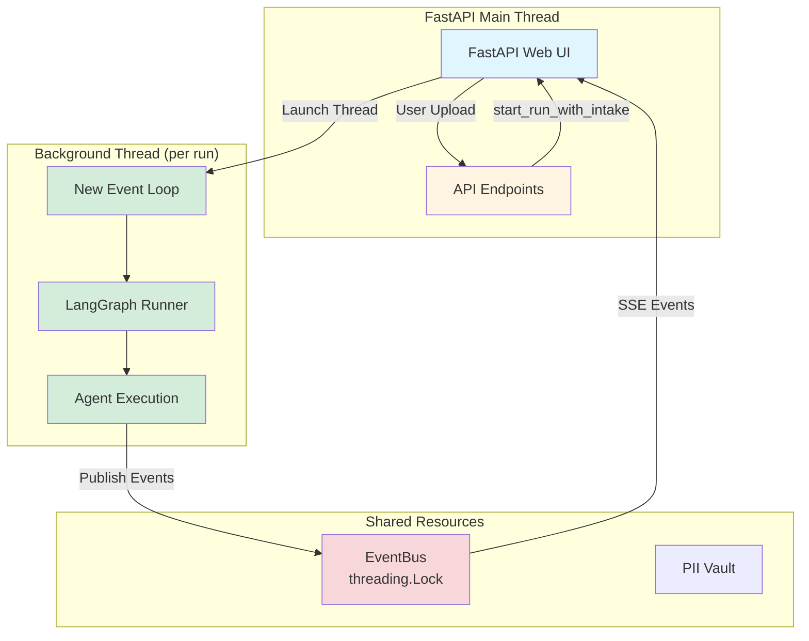

# Architecture Diagram

## System Overview



## Agent Swarm Details

```mermaid
graph LR
    subgraph "Agent 1: Profile Enricher"
        A1_IN[Input: Scrubbed Resume]
        A1_PROC[Process: Extract Skills,<br/>Projects, GPA]
        A1_EXT[External: GitHub Profile]
        A1_OUT[Output: Enriched Profile]
    end

    subgraph "Agent 2: Opportunity Scout"
        A2_IN[Input: Enriched Profile]
        A2_PROC[Process: Search Queries<br/>Based on Profile]
        A2_EXT[External: Search APIs]
        A2_OUT[Output: Raw Opportunities<br/>(10+ candidates)]
    end

    subgraph "Agent 3: Source Auditor"
        A3_IN[Input: Raw Opportunities]
        A3_PROC[Process: Fetch Official URLs,<br/>Extract Requirements,<br/>Verify Trust Tier]
        A3_EXT[External: Web Fetch]
        A3_OUT[Output: Verified Opportunities<br/>with Evidence]
    end

    subgraph "Agent 4: Ranking Strategist"
        A4_IN[Input: Verified Opportunities]
        A4_PROC[Process: Score Alignment,<br/>Analyze Gaps,<br/>Rank by Fit]
        A4_EXT[External: LLM Reasoning]
        A4_OUT[Output: Top-5 Ranked<br/>with Rationale]
    end

    subgraph "Agent 5: Application Strategist"
        A5_IN[Input: Top-5 + Profile]
        A5_PROC[Process: Draft SOP,<br/>Claim Ledger,<br/>Citations]
        A5_EXT[External: LLM Generation]
        A5_OUT[Output: Application Package<br/>(SOP + Evidence)]
    end

    A1_OUT --> A2_IN
    A2_OUT --> A3_IN
    A3_OUT --> A4_IN
    A4_OUT --> A5_IN

    style A1_IN fill:#e3f2fd
    style A1_OUT fill:#c8e6c9
    style A2_IN fill:#e3f2fd
    style A2_OUT fill:#c8e6c9
    style A3_IN fill:#e3f2fd
    style A3_OUT fill:#c8e6c9
    style A4_IN fill:#e3f2fd
    style A4_OUT fill:#c8e6c9
    style A5_IN fill:#e3f2fd
    style A5_OUT fill:#c8e6c9
```

## Resilience Architecture



## Hexagonal Architecture (Ports & Adapters)



## Data Flow



## Hard Invariants



## Background Thread Execution (DEC-IMPL-016)


