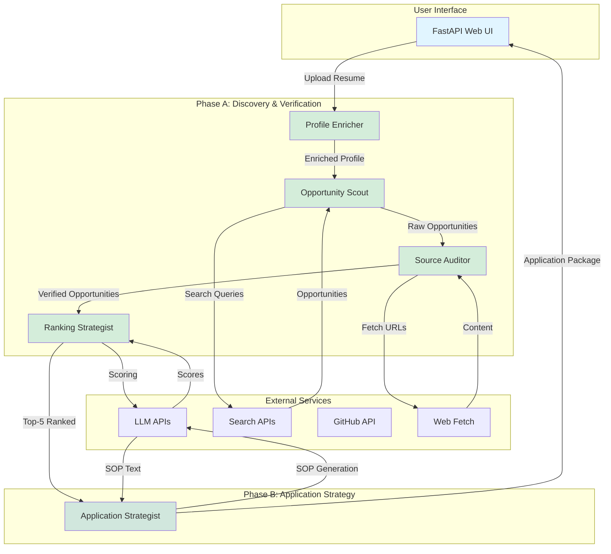

# 🎓 Autonomous Multi-Agent AI Scholarship Finder

> **Production-ready prototype** — Two-phase autonomous pipeline that discovers, audits, ranks, and drafts applications for graduate scholarships and programs.

---

## Quick Start

```bash
# 1. Clone and install
git clone https://github.com/Emperor-4037/ScholarLift.git
cd ScholarShip_Finder
pip install -e ".[dev]"

# 2. Configure API keys
cp .env.example .env
# Edit .env — add GEMINI_API_KEY + TAVILY_API_KEY at minimum

# 3. Pre-flight check (optional)
python -m scholarship_finder.preflight

# 4. Run the application
scholarship-run
# Open browser to http://localhost:8000
```

---

## Architecture Overview



### How It Works

**Step 1: Intake & Privacy Protection**
- User uploads resume (PDF, text, or markdown)
- PII scrubbing removes names, emails, phone numbers
- Secure vault stores sensitive data with 15-minute auto-purge

**Step 2: Phase A - Discovery & Verification (≤90 seconds)**
- **Profile Enricher**: Extracts skills, projects, GPA, enriches with GitHub profile
- **Opportunity Scout**: Generates search queries, discovers 10+ opportunities via Tavily API
- **Source Auditor**: Fetches official websites, verifies requirements and trust tiers
- **Ranking Strategist**: Scores field alignment, ranks top 5 opportunities

**Step 3: Phase B - Application Strategy (≤120 seconds)**
- **Application Strategist**: Drafts Statement of Purpose with claim ledger for anti-hallucination

**Step 4: Results**
- Top-5 opportunities displayed with match scores, funding, deadlines
- SOP available for export (Markdown/PDF)
- User can purge all data immediately

### Key Features

- **Autonomous Coordination**: Agents communicate via EventBus without human intervention
- **Resilience Stack**: 6-layer middleware (telemetry, cache, quota governor, circuit breaker, retry, timeout)
- **Anti-Hallucination**: Two-stage verification (span verification + claim ledger)
- **Privacy by Design**: PII scrubbed before any external API call
- **Hard Invariants**: ≤4 reasoning calls per run, phase deadlines, typed outcomes
- **Real APIs**: Uses actual search (Tavily), LLM (Gemini), and GitHub APIs

---

## Key Components

| Layer | Files | Purpose |
|-------|-------|---------|
| **Domain** | `domain/` | Pure deterministic logic — GPA, scoring, PII, claim verification |
| **Ports** | `ports/` | Abstract interfaces (LLM, Search, Fetch, Document, ProfileSource) |
| **Adapters** | `adapters/` | Gemini, OpenAI, Tavily, Jina, GitHub, PDF, FetchChain |
| **Resilience** | `resilience/` | 4-state breaker, quota governor, retry, timeout, middleware |
| **Agents** | `agents/` | 5 agents + intake service |
| **Engine** | `engine/` | LangGraph graph, EventBus, RunGateway |
| **Web UI** | `web/` | FastAPI backend + HTML/CSS/JS frontend |
| **API** | `api/` | REST API endpoints and SSE events |

---

## Hard Invariants

| Invariant | Enforcement |
|-----------|------------|
| **No hardcoded model IDs** | All tiers in `.env` chain strings |
| **≤4 reasoning calls/run** | `QuotaGovernor` raises at 5th call |
| **PII never leaves Intake** | `PIIScrubber` + `PIIVault` before any LLM/search call |
| **Anti-hallucination Stage 1** | `verify_span()` per extracted attribute |
| **Anti-hallucination Stage 2** | `verify_sop()` claim ledger per sentence |
| **Phase A ≤90s** | `RunGateway` `asyncio.wait_for` hard deadline |
| **Phase B ≤120s** | Combined deadline in gateway |
| **Typed terminal outcomes** | `COMPLETE / DEGRADED / PARTIAL / FAILED_SAFE` |
| **Discipline-agnostic prompts** | All prompts field-free; no domain mentions |

---

## Environment Variables

```env
# Core (required for live mode)
GEMINI_API_KEY=...          # Google AI Studio key
TAVILY_API_KEY=...          # Tavily search

# Optional enrichment
OPENAI_API_KEY=...          # OpenAI-compatible fallback LLM
OPENAI_API_BASE_URL=...
JINA_API_KEY=...            # Jina secondary search / reader
SERPER_API_KEY=...          # Alternative secondary search
GITHUB_TOKEN=...            # GitHub profile enrichment

# LLM tier chains (model IDs never in code)
TIER_FAST_CHAIN=gemini-3.5-flash-lite,gemini-3.6-flash
TIER_REASONING_CHAIN=gemini-3.6-flash
TIER_VISION_CHAIN=gemini-3.5-flash

# Deployment
DEPLOYMENT_PROFILE=LITE     # LITE (Streamlit Cloud) | FULL (FastAPI)
MAX_CONCURRENT_RUNS=3
MAX_REASONING_CALLS_PER_RUN=4

# Privacy
PII_VAULT_TTL_SECONDS=900   # 15-minute auto-purge

# PDF backend
PDF_BACKEND=pymupdf         # pymupdf (AGPL) | pypdf (MIT)
```

---

## Running Tests

```bash
# All tests (242 total)
python -m pytest tests/ -v

# By phase
python -m pytest tests/test_domain/          # Phase 1 — 177 tests
python -m pytest tests/test_resilience/     # Phase 2 — 50 tests
python -m pytest tests/test_phase3/         # Phase 3 — 15 tests

# Zero live API calls — all use mocks/fixtures
```

---

## Project Structure

```
ScholarShip_Finder/
├── src/scholarship_finder/
│   ├── domain/          # GPA, URL, trust, span verifier, tri-state, scoring, claim, PII, reducers
│   ├── ports/           # LLM, Search, Fetch, Document, ProfileSource protocols
│   ├── adapters/        # Gemini, OpenAI, Tavily, Jina, GitHub, PDF, FetchChain
│   ├── resilience/      # breaker, quota, retry, cache, timeout, middleware, telemetry
│   ├── agents/          # intake, profile_enricher, opportunity_scout, source_auditor,
│   │                    #   ranking_strategist, application_strategist
│   ├── engine/          # event_bus, gateway, graph (LangGraph)
│   ├── web/             # FastAPI web UI (HTML/CSS/JS)
│   ├── api/             # REST API endpoints and SSE events
│   ├── cli.py           # CLI entry point for scholarship-run
│   ├── composition.py   # Dependency injection root
│   ├── config.py        # Pydantic-settings typed config
│   ├── errors.py        # Normalized error taxonomy
│   └── preflight.py     # Pre-flight canary probe
├── tests/
│   ├── test_domain/     # Unit tests for all domain services
│   ├── test_resilience/ # Breaker, quota, middleware tests
│   └── test_phase3/     # End-to-end smoke tests
├── pyproject.toml
├── .env.example
└── ARCHITECTURE.md      # Detailed system architecture diagrams
```

---

## Key Implementation Decisions

- **Single models.py**: Avoids Pydantic v2 forward-ref issues
- **google-genai SDK**: Recommended replacement for deprecated google-generativeai
- **Single decorate() composition**: Entry point for the 6-layer middleware
- **PDF adapter auto-fallback**: PyMuPDF → pypdf without raising errors

---

## License

MIT (pypdf backend) / AGPL-3.0 (PyMuPDF — not distributed, local use only).
Select `PDF_BACKEND=pypdf` for fully MIT deployments.
